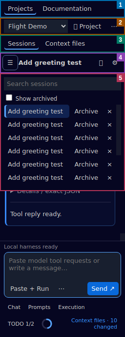
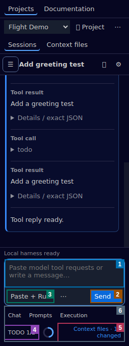

# Complete chat walkthrough

This uses disposable Python source and real local pytest evidence. The WebUI is the model; RepoPilot is its local tool harness. No model API, account connection or browser automation is involved.

## Configure the project, then open a chat

For a synthetic project, a source developer can run:

```bash
uv run --frozen python examples/create_demo.py /tmp/repopilotv3-demo
```

Alternatively create `greeter.py` with a small function and a failing test in a disposable folder. Install the single VSIX, open that folder in a trusted VS Code window, and open RepoPilot.

If your VS Code workspace contains multiple projects, choose **Projects → Add project folder** and browse to the one project you want RepoPilot to use. Its path appears in the options menu and is remembered after reload. Other folders remain open in VS Code. Hover a control to see its short purpose.

Use **Prompts → Copy project prompt** and paste the result into your WebUI project's instructions once. This standalone document explains behavior, TODOs, the JSON tools, approval and evidence rules. It stays below 8,000 characters. Repository maps and source remain separate context files.

Click **New session**. It opens a chat and copies a short starter. Paste that into a new external chat within the configured WebUI project. It introduces this session identity, then asks for the objective. It does not repeat the project instructions, protocol catalog or source map. No separate task/name/project dialogs are required.

The message input grows upward as text wraps, up to 30% of the panel height, then scrolls internally. It shrinks again when you shorten or send the message and resizes when the panel width changes.

Write your goal in the WebUI, or type it into RepoPilot and choose **Send**, then paste the prepared prompt there: “Fix greeting punctuation without changing the Greeter interface.” Send prepares text; it does not execute typed commands.

The model can answer with prose and two JSON blocks:

```json
{"protocol_version":"1.0","request_id":"task-1","tool":"task","arguments":{"objective":"Fix greeting punctuation without changing the public API","chat_name":"Greeting punctuation","seeds":["greeter.py"]}}
```
```json
{"protocol_version":"1.0","request_id":"todo-1","tool":"todo","arguments":{"progress":{"items":[{"id":"inspect","text":"Inspect greeting and regression test","status":"active"},{"id":"fix","text":"Correct punctuation and verify tests","status":"pending"}]}}}}
```

Paste the entire model reply into the composer and click **Send**, or use **Paste + Run** directly from the clipboard. The model may also put both objects into one JSON fence, separated by a newline, or send an array of requests. The chat gets its name, the task becomes persistent and the TODO appears in the bottom bar. One pasted reply is one recorded conversation message, even with multiple tools. Tool calls, results and status messages appear together under one harness turn with one **Copy** button. It copies the complete saved turn, including results outside the displayed history page. Automatic copying uses the same complete turn; paste it back into the WebUI. Expand individual results for details without having to copy each fragment.

Open **Sessions** to switch chats. Each row has **Archive** and **Delete** controls. Archive hides the chat; enable **Show archived** and choose **Restore** to bring it back. Delete asks for confirmation and removes that chat's transcript, draft and conversation counts. Shared tasks, validation/command evidence, immutable packages and recovery files remain. The same controls are available under **Chat** for the selected chat. Deleting the last chat returns to the empty view; creating another chat never replays the deleted requests.

## Change modes and retrieve only needed source

Use **Prompts → Copy Planning prompt** when you want planning guidance. When ready, copy the Implementation prompt and paste it into the WebUI. Asking and Review work the same way. These copy exact project-owned Markdown and do not change session settings or permissions.

The model can retrieve bounded source:

```json
{"protocol_version":"1.0","request_id":"read-1","tool":"batch","arguments":{"calls":[{"tool":"read","arguments":{"path":"greeter.py","start":1,"end":40}},{"tool":"read","arguments":{"path":"test_greeter.py","start":1,"end":40}}]}}
```

Paste + Run, then paste the response back. It includes source ranges, hashes and snapshot metadata. The model should reuse these results until the source changes.

## Inspect and approve changes

The model returns `propose_patch` with the **actual snapshot and hash** from retrieval and complete proposed file contents. Replace the illustrative snapshot/hash below with returned values:

```json
{"protocol_version":"1.0","request_id":"patch-1","tool":"propose_patch","arguments":{"base_snapshot":"ACTUAL_SNAPSHOT","base_hashes":{"greeter.py":"ACTUAL_HASH"},"files":{"greeter.py":"\"\"\"Small synthetic greeting module.\"\"\"\n\n\nclass Greeter:\n    \"\"\"Build a greeting for one person.\"\"\"\n\n    def greet(self, name: str) -> str:\n        \"\"\"Return the current greeting behavior.\"\"\"\n        return f\"Hello, {name}!\"\n"}}}
```

RepoPilot generates and counts the diff locally. `files` maps paths to complete contents, `null` deletes, and `""` creates/empties a file. Additions use `null` base hashes; existing files require their current hashes. Never send a partial file as replacement contents. Legacy unified `diff` proposals remain available for bounded edits in large files; do not send both formats.

Paste + Run automatically opens a permanent native diff tab for every proposed file. Source is unchanged. Inspect the read-only original/proposed documents and choose **Approve whole proposal** in the chat. No file-picker step is needed. Dirty affected buffers or changed source prevent application.

To run actual tests after approval, select **Execution → Validation profile → python** beforehand. This approves the bundled pytest profile locally; dependencies are already present. Approval applies the complete proposal, runs that configured profile, and returns actual evidence. No profile means validation is explicitly not run. A failing profile does not undo an applied source change.

## Run a command when needed

The model can request:

```json
{"protocol_version":"1.0","request_id":"check-1","tool":"run_command","arguments":{"argv":["python","-m","pytest","-q"],"timeout":300}}
```

For C# use argv such as `["dotnet","build","--no-restore"]`; SDK configuration chooses the executable. On first use, the chat displays the exact command and working directory. Choose **Allow commands for this session** to execute it and authorize subsequent commands. This permission persists for this chat and can be revoked from Execution.

Commands run with your account permissions, can modify files/use the network, and are noninteractive. Ordinary source edits should still use reviewed patches. RepoPilot asks you to save or cancel dirty workspace source buffers before execution. Live output appears in the transcript; **Stop** cancels the command tree. Eligible source changes observed during execution open native diff tabs afterward.

Complete logs stay private. The model can use command_output with the returned command ID and bounded line ranges. Generic command exit status is actual execution evidence but does not establish that tests ran; the validate tool/profile records genuine JUnit/TRX test counts.

## Refresh WebUI files from the message bar

The bottom bar contains:

`Implementation ▾   TODO 1/2   Context ~18k/40k   Context files · 3`

Source/task changes refresh packages automatically. **Context files** opens the upload checklist without an extra generation step. If a refresh fails, it shows the cause and **Retry refresh**. Use **Open folder** and upload/replace your chosen files. Compact packages contain repository maps, protocol/schema reference, focused task source, TODO and validation evidence. Optional full-source Markdown is selected through **Context files → Package settings**.

Use **Copy instructions** or **Prompts → Copy project prompt** for the reusable project guidance. Session starters rely on those separately configured instructions. Local copying does not prove a remote paste or replace attachments. Choose **Confirm transfers** only after completing the exact external uploads/pastes. KEEP means confirmed content is still valid; UPLOAD/PASTE/REPLACE identify required action. A revised project prompt is flagged for replacement even when source files are unchanged.

## Continue, recover and correct errors

The model updates todo as work proceeds. Local build/test evidence remains independent from model-reported completion. At the default 40,000 observed estimated tokens, RepoPilot adds an advisory to the next tool reply and prepares a handoff packet; it does not block work. Change the threshold through the context ring. The estimate cannot measure the WebUI's hidden retrieval, summaries or actual remaining capacity.

At the threshold choose **Continue in new chat**, or use **Chat → Generate handoff** at any time. Open a fresh external chat in the configured project and confirm that it is open. The replacement session keeps the task, gets its own identifier and continuation starter, and requires a new initial todo call and command grant. Its starter carries progress and evidence without repeating the project prompt. Copy/paste it and continue.

For malformed JSON, missing executables or stale source, RepoPilot provides a copy-ready cause and corrective next step. Paste it back so the model can repair its next call with a **new request ID**. All tool blocks validate before the first executes. Identical requests return saved results; conflicting ID reuse is rejected.

After a disconnect, **Reconnect backend** restores passive history and drafts. Nothing is replayed. Interrupted effects must be inspected before another action. Use **Execution → Recovery checkpoint** when the previous model is unavailable. Source recovery remains an explicit CLI/management operation and refuses to overwrite later edits.

Copilot fallback uses the same task checkpoint: manually place the static harness, save a task with task_checkpoint during API work, then resume its task ID in the WebUI task tool or the CLI's session create --task option. MCP remains retrieval/checkpoints; Copilot uses native editing, terminal and test tools.

Harness Copy now provides a short summary followed by fenced `tool_results` JSON. Internal counters/timestamps and duplicate task/TODO presentations are omitted; source, hashes, errors, local validation and pending work remain. Paste this **into the WebUI model**, then return its next requests to RepoPilot. Blue message backgrounds distinguish the developer, model and harness; the selected session has a blue marker.

`search` is keyword search: use short identifiers. Use `query: "*"` for a bounded eligible-file list. `indexed_file_count: 0` means no eligible source was found; an empty `hits` list alone only means no matches. An intended empty project can proceed with additions using the returned snapshot and null base hashes.

Generated export folders/cache are cleaned automatically once their combined size exceeds 512 MiB. Current and recent packages remain protected; use **Open folder** for the current generation rather than bookmarking an older upload directory. Cleanup never updates the external WebUI or deletes task/validation/recovery records.

## Copilot setup without a manual session

Select your individual project through **Projects → Add project folder**. Open **Copilot & MCP → Enable MCP for selected project**. If a legacy entry is found, keep it or preview the migration; unrelated entries stay intact. The native provider appears in the editor's MCP tool picker under the project-specific RepoPilot name. Use the editor's normal server trust/start controls.

Choose **Generate / update workspace harness**, inspect its diff tabs and apply. Existing instructions outside the managed block remain. A conflicting local agent/hook requires review instead of overwrite. Use **Open workspace .github** to inspect results, **Open bundled harness** for the original static assets, and **MCP status** to see roots and launch paths. No manual chat session is required. Changing the selected folder does not redirect servers already serving other projects; enable or disable each root explicitly.

## Project navigation and independent role prompts

Open **Projects**, add a second disposable source folder, and switch between them using the selector. Each folder restores its own selected chat and draft. Inside a project, open **Context files** to inspect generated Markdown and use **Open file**, **Open folder** and **Confirm transfers** (or **Retry refresh** on failure). Removing a listing keeps all source and private session data.

Use **Prompts → Copy Implementation prompt** to send implementation guidance. There is no active mode. Use **Edit prompts**, change the Markdown, save it and copy again to verify that your saved text is used exactly. Reset restores the bundled default and retains a recovery copy.

To practice checklist recovery, use **TODO → Reset checklist**. Confirm that old items remain in task history and validation still appears. Paste the reset message into the WebUI and ask it to call `todo` with a new request ID before further tools.

The **Documentation** tab contains these illustrated controls and searchable summaries:



1. Projects / Documentation tabs.
2. Folder-space selector and Add project.
3. Sessions / Context files tabs.
4. Current chat, New session and Options.
5. Searchable saved-session drawer.



1. Composer for pasted tool requests or developer prose.
2. Send with automatic request detection.
3. Paste + Run directly from the clipboard.
4. Collapsible TODO.
5. Automatically maintained Context files and the context ring.
6. Chat, Prompts and Execution menus beside the composer.

These are annotated captures of the actual extension using synthetic source and session content.


The **Settings** menu is anchored below its cogwheel. Press **Escape** to close any custom menu (including the session drawer, composer actions, TODO and upload checklist); focus returns to its opening control. Clicking outside closes menus too. Escape does not stop commands or send messages.

The circular **context indicator** fills against the selected chat’s configured advisory limit. Hover or focus it to see **Context window: % full** and **used/limit tokens used**. These are locally recorded estimates, not measured WebUI usage. Clicking the circle changes the limit. At/above the limit the ring stays full while hover text shows the actual percentage, including values over 100%.


## Find a control in help

Open **Documentation** and select Quick start, Daily workflow or Reference. Colored numbered badges match the screenshot callouts. Click an image to enlarge it; Escape closes it. Search highlights matching words, and Previous/Next match jumps between them. Clearing the search restores topic browsing.

## Optional local browser demo

The normal loop above remains the default. To try the experiment without a provider, follow the short [local demo walkthrough](browser-relay.md#local-demo). The demo uses the same protocol parser and approvals as normal sessions, but only requests a task, TODO and repository search. Its responses are scripted; it does not demonstrate model quality or provider compatibility.
